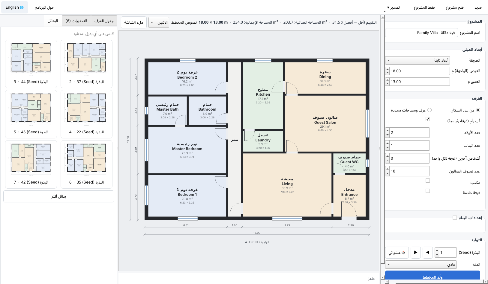

# Floor Plan Studio

مولّد مخططات منازل مبني على قواعد التصميم. بتعطيه أبعاد المبنى أو المساحات أو عدد السكان، وهو بيطلع مخطط كامل فيه جدران وأبواب وشبابيك وأبعاد. وبتقدر تصدّره **2D** (SVG) و**CAD** (DXF) و**3D** (GLB/OBJ).

A rule-based house floor plan generator. Give it dimensions, room areas or a household, get a complete plan with walls, doors, windows and dimensions, exported to 2D (SVG), CAD (DXF) and 3D (GLB/OBJ).

---

## الفكرة / How it works

1. **برنامج الفراغات:** من عدد السكان (أب وأم، أولاد، بنات، ضيوف) بيحسب البرنامج الغرف المطلوبة ومساحة كل وحدة حسب القواعد بملف `floorplan/rules/jordan.py`. مثلاً كل غرفة نوم فيها شخصين على الأكثر، والأولاد بغرف منفصلة عن البنات، ومساحة الصالون بتعتمد على عدد الضيوف. وإذا بدك، بتقدر تكتب الغرف ومساحاتها بنفسك.
2. **التوليد بالـ Seed:** الأبعاد الخارجية بتضل ثابتة، والـ Seed بيغيّر بس التوزيع. لكل Seed البرنامج بيجرب مئات الحلول، وبيختار الأفضل حسب القواعد:
   - المساحات
   - أقل عرض للغرفة
   - نسبة الطول للعرض
   - كل غرفة سكنية إلها شباك
   - كل غرفة إلها طريق من الباب الرئيسي
   - ما في غرفة الدخول إلها من غرفة نوم
   - المطبخ جنب السفرة، والصالون جنب المدخل
3. **الأبواب:** بتنبني كشجرة بتبدأ من الباب الرئيسي. لكل غرفة في قائمة "من وين بيندخل عليها"، والقائمة مرتبة حسب الأفضلية.
4. **التحذيرات:** كل مخالفة للقواعد بتطلع رسالة بالعربي والإنجليزي.

> ⚠️ أرقام القواعد ونظام الأبنية الموجودة بالبرنامج (الارتدادات ونسب البناء لسكن أ/ب/ج/د) **قيم تقريبية للبداية**. لازم تتأكد منها من النظام الساري قبل ما تعتمدها بأي مشروع. وكل قيمة فيها بتقدر تعدلها.

## البرنامج / Desktop app



### تنزيل ملف exe لويندوز (الأسهل)

1. افتح صفحة **[Releases](https://github.com/essamnawafleh-oss/floorplan-studio/releases/tag/latest)**.
2. نزّل **`FloorPlanStudio.exe`** وافتحه بدبل كليك. ما بتحتاج تثبّت بايثون ولا أي إشي ثاني.
   - أول مرة ممكن ويندوز يطلعلك "Windows protected your PC". هاد طبيعي لأي برنامج جديد مش موقّع رقمياً: اكبس **More info** وبعدين **Run anyway**.
   - الفتح بياخد كم ثانية، لأنه البرنامج كله ملف واحد.

ملف الـ exe بينبني تلقائياً على GitHub مع كل تحديث للكود.

### شو بيعمل البرنامج

- **لوحة المدخلات:**
  - أبعاد المبنى بـ 5 طرق: أبعاد ثابتة، عرض ثابت، عمق ثابت، قطعة أرض مع تنظيم، أو تلقائي.
  - الغرف من عدد السكان، أو غرف بمساحات بتحددها انت.
  - إعدادات البناء: سماكة الجدران، عرض الممر، الارتفاعات.
- **المخطط بيتحدث تلقائياً** مع كل تعديل. بتكبّر وبتصغّر بعجلة الماوس، وبتحرك المخطط بالسحب، ولما تكبس على غرفة بتنحدد بالجدول.
- **الـ Seed:** أزرار ◀ ▶ و"عشوائي"، والأبعاد بتضل ثابتة.
- **الغرف الاختيارية:** شيل الصح عن أي غرفة مش لازمة (غسيل، حمام ضيوف، سفرة، مدخل...) وبتنحذف من البرنامج.
- **التزام صارم بالمساحات:** لما تفعّله البرنامج بيرفض أي توزيع فيه غرفة أصغر من الحد الأدنى أو ضيقة أو بدون شباك. وإذا ما لقى توزيع، بيحكيلك السبب وشو تعمل.
- **تبويب البدائل:** 6 بدائل لنفس الأبعاد كصور مصغرة، كبسة وحدة وبتختار البديل.
- **جدول الغرف:** المساحة المطلوبة مقابل الفعلية، والأبعاد.
- **التحذيرات:** كل مخالفة للقواعد، بالعربي والإنجليزي.
- **التصدير:** SVG، PNG بدقة عالية، PDF بحجم A3، DXF، GLB، OBJ، JSON، أو كلهم مرة وحدة لمجلد.
- **حفظ وفتح المشروع** كملف `.json`.
- **اللغة:** عربي أو إنجليزي للواجهة، ولنصوص المخطط كمان.
- **⚙ الإعدادات:**
  - الثيم: حسب ويندوز، فاتح، داكن، كحلي، رملي، أو **ثيم مخصص من ملف**.
  - اللون الرئيسي، وخط الواجهة وحجمه.
  - ألوان المخطط: حسب الثيم، أو فاتح، أو داكن.
  - التصدير دايماً بألوان فاتحة جاهزة للطباعة.

### وضع التعديل ✏

فعّله من زر **✏ وضع التعديل**:

- **الجدران:** اسحب أي جدار داخلي أو خارجي بالماوس. الحركة بخطوات 5 سم، واضغط Alt لتلغي الالتقاط. أو اكتب الموقع من **الخصائص**.
- **الغرف:** غيّر الاسم أو النوع، أو حدد العرض والطول الصافي.
- **الأبواب والشبابيك:** أضفها بأزرار **+ باب** و**+ شباك** و**+ باب رئيسي**، واسحبها على الجدار. غيّر العرض وارتفاع الجلسة، واعكس جهة الفتح والمفصلة، واختار **رمز (بلوك)** من المكتبة.
- **الأثاث:** من تبويب **المكتبة** دبل كليك على قطعة، وبعدين كبسة على المخطط. R بتدوّر، Delete بتحذف، والسحب بيحرّك.
- **التراجع والإعادة:** Ctrl+Z و Ctrl+Y. التعديلات بتنحفظ مع المشروع.

### المكتبة (البلوكات)

- قطع جاهزة: أثاث، صحي، مطبخ، أبواب، شبابيك.
- **استيراد DXF:** كل Block بالملف بيصير قطعة بالمكتبة. الوحدة (mm أو cm أو m) بتنقرأ تلقائياً أو بتختارها انت.
  - قطع الأثاث: نقطة الأساس بالزاوية السفلية اليسرى.
  - الأبواب: بترسمها بعرض الباب، والمفصلة عند النقطة (0,0).
  - الشبابيك: على طول الشباك، وبعرض الجدار.
- القطع بتنحفظ بمجلد المستخدم (`%APPDATA%\FloorPlanStudio\blocks`).
- بالتصدير لـ DXF الأثاث بيطلع **Blocks حقيقية (INSERT)**.

### القياس 📏📐 والمقياس

- **قياس طول:** نقاط متتالية مع مجموع الأطوال. **قياس مساحة:** مضلّع، بيعطيك المساحة والمحيط.
- القياس بيلتقط زوايا الغرف والفتحات والأثاث، وShift بيخلي الخط مستقيم. الوحدات: m أو cm أو mm أو ft.
- **المقياس:** المقياس الحالي على الشاشة بيبين فوق المخطط (مثلاً 1:86)، وفي قائمة لاختيار 1:50 أو 1:100... وتحت المخطط في مسطرة مقياس.
- **PDF بمقياس حقيقي:** بتختار الورقة (A4 لـ A1) والمقياس (1:50، 1:100...)، والطباعة بتطلع بالمقياس المزبوط.

### عرض 3D 🧊

عارض ثلاثي الأبعاد جوا البرنامج: سحب للتدوير، زر يمين للتحريك، والعجلة للتكبير. فيه زر يخفي الأثاث، ومنزلقة بتنزّل ارتفاع الجدران عشان تشوف جوا. وزر **افتح ببرنامج خارجي** بيفتح ملف GLB ببرنامج 3D Viewer أو Blender.

### حاسبة الكميات 🧮

- **الطوب:** للجدران الخارجية (طبقة الطوب ورا الحجر والخرسانة) وللجدران الداخلية، بعد خصم الفتحات. بتحدد مقاس الطوبة (40×20 افتراضي) والمونة ونسبة الهدر.
- **البلاط:** لكل غرفة وللمجموع. مقاسات جاهزة (20×20 لـ 60×120) أو مقاس مخصص، مع الفاصل والهدر وعدد الكراتين.
- **الدهان:** للواجهات الخارجية، ولكل غرفة من جوا (جدران وسقف)، باللتر والجالون، حسب التغطية وعدد الأوجه.
- تصدير **CSV** بيفتح بالإكسل.

### الإضافات بالبايثون 🧩

مثل إضافات بلندر. من **🧩 الإضافات ▾** اختار **إدارة الإضافات…**، وبعدين **جديدة**، واكتب الكود وكبسة **حفظ وتفعيل**. الأداة بتطلع بقائمة الإضافات.

```python
ADDON = {"name": "My tool", "description": "...", "version": "1.0"}

def register(api):
    api.add_action("Room areas", lambda: api.message(
        "\n".join(f"{r.spec.name_en}: {r.net.area:.2f} m2" for r in api.plan.rooms)))
```

- **الـ `api`:**
  - البيانات: `plan`، `library`، `config()`، `quantities()`.
  - التعديل: `edit(fn)` تعديل بيقبل التراجع، `regenerate(seed)`، `export(kind, path)`.
  - الواجهة: `add_action`، `message`، `ask_text`، `ask_number`، `save_file`، `status`.
- البرنامج فيه 3 إضافات أمثلة: جدول الغرف CSV، تأثيث تلقائي، وملخص الجدران والإضاءة.
- ⚠️ الإضافات بتشتغل بكامل الصلاحيات، ففعّل بس الكود اللي بتثق فيه.

### ثيم مخصص

انسخ ملف [`docs/theme_example.json`](docs/theme_example.json) وغيّر الألوان فيه (أكواد hex). بعدين من **الإعدادات** اختار **الثيم**، ثم **تحميل ثيم…**.

| المفتاح | وين بيبين |
|---|---|
| `window` | خلفية البرنامج |
| `card` | خلفية الصناديق والجداول وشريط الأدوات |
| `border` | الحدود والخطوط الفاصلة |
| `input` / `input_border` | خانات الإدخال |
| `text` / `muted` | النص الأساسي، والنص الثانوي |
| `hover` / `selection` | لون المرور بالماوس، ولون التحديد |
| `canvas` | الخلفية حوالين المخطط |
| `accent` / `accent_text` | الزر الرئيسي ولون النص فوقه |
| `warn` | لون التحذيرات |
| `plan` | ألوان المخطط: `light` أو `dark` |

### تشغيل البرنامج من الكود

```bash
pip install -r requirements-gui.txt
python FloorPlanStudio.py
```

### بناء ملف exe على جهازك (اختياري)

```bash
pip install -r requirements-gui.txt
pyinstaller FloorPlanStudio.spec --noconfirm     # الملف بيطلع بمجلد dist/
```

## التشغيل من سطر الأوامر / Command line

```bash
python -m venv .venv
.venv/bin/pip install -r requirements.txt

# 4 بدائل لنفس الأبعاد
.venv/bin/python -m floorplan examples/family.json --seeds 1 2 3 4 --out out

# الصيغ المتوفرة: svg dxf glb obj json
.venv/bin/python -m floorplan examples/fixed_rooms.json --seeds 7 --formats svg dxf obj
```

## ملف المشروع / Project file

```jsonc
{
  "project": "فيلا عائلة",
  "rules": "jordan",

  // اختار وحدة من هدول الثلاثة:
  "footprint": {"width": 18, "depth": 13},        // أبعاد ثابتة
  // "footprint": {"width": 14},                  // عرض ثابت والعمق بينحسب
  // "plot": {"width": 25, "depth": 32, "zoning": "amman_res_c"},  // قطعة أرض + تنظيم

  // الغرف إما من السكان...
  "household": {"parents": true, "sons": 2, "daughters": 1, "others": 0, "guests": 10,
                "office": false, "maid": false},
  // ...أو بتكتبها بنفسك (المساحة الثابتة بتتحافظ عليها):
  // "rooms": [{"type": "salon", "area": 22}, {"type": "bedroom", "occupants": 2}],

  "settings": {"exterior_wall": 0.30, "interior_wall": 0.15, "corridor": 1.20, "wall_height": 3.0},
  "lang": "both",     // لغة نصوص المخطط: ar | en | both
  "dxf_lang": "en"    // الإنجليزي أضمن بالأوتوكاد
}
```

أنواع الغرف المتوفرة: `entrance salon living dining kitchen guest_wc laundry storage maid master ensuite bedroom bathroom office`

## المخرجات / Outputs

| الملف | المحتوى |
|---|---|
| `.svg` | مخطط 2D ملوّن فيه أسماء الغرف ومساحاتها، والأبعاد، وفتحات الأبواب |
| `.dxf` | ملف CAD بطبقات: `A-WALL`, `A-WALL-HATCH`, `A-DOOR`, `A-GLAZ`, `A-AREA` (حدود الغرف لحساب المساحات), `A-ANNO-TEXT`, `A-ANNO-DIMS`. الوحدة متر |
| `.glb` / `.obj` | موديل 3D فيه الجدران، وفتحات الأبواب والشبابيك، والأعتاب، والزجاج، والأرضيات |
| `.json` | كل بيانات المخطط، لأي برنامج ثاني |

## هيكل الكود / Code layout

```
floorplan/
  rules/jordan.py   القواعد: أنواع الغرف، الحدود الدنيا، العلاقات، نظام الأبنية
  program.py        السكان أو الغرف -> برنامج الفراغات + حساب الأبعاد
  layout.py         المولّد والتقييم
  openings.py       الأبواب والشبابيك
  geometry.py       جيومتري الجدران (shapely)
  export/           svg / dxf / mesh3d
  cli.py            واجهة سطر الأوامر
tests/              اختبارات (pytest)
```

## خطة التطوير / Roadmap

- [x] **المرحلة 1:** المحرك، والقواعد الأردنية، والتوليد بالـ Seed، والتصدير SVG / DXF / GLB / OBJ
- [x] **المرحلة 2أ:** برنامج سطح مكتب بالعربي والإنجليزي، فيه بدائل وتصدير، وملف exe بينبني تلقائياً
- [x] **المرحلة 2ب:** وضع التعديل، المكتبة، القياس والمقياس، عارض 3D، الكميات، الإضافات بالبايثون
- [ ] **المرحلة 3:** معاينة 3D جوا البرنامج، ومواد، وأثاث أساسي، وتصدير PDF بلوحة عنوان ومقياس رسم
- [ ] **المرحلة 4:** أراضي غير منتظمة (من رفع مساحي أو DXF)، وأكثر من طابق مع درج، وتصدير IFC، وإضافة لبلندر
